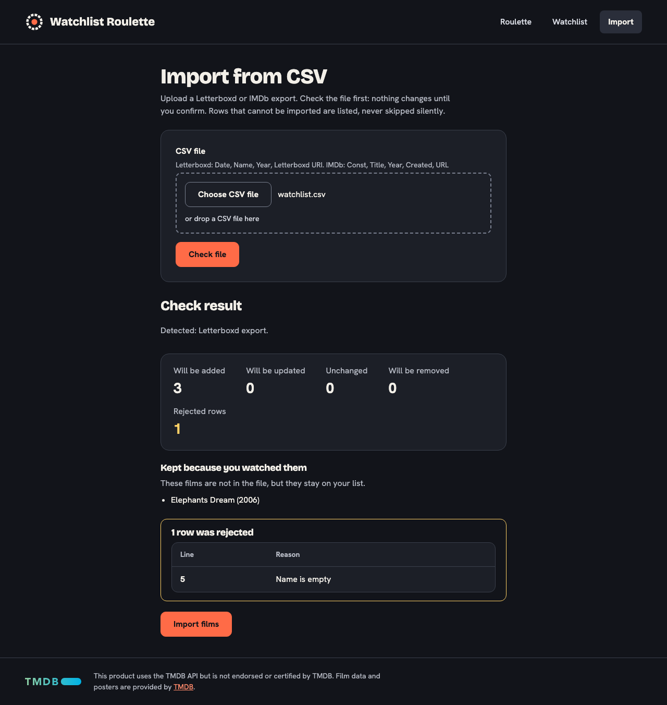

# CSV import

Route `/import`. Imports a Letterboxd or an IMDb export in two steps, like the backend ([CSV import](../backend/csv-import.md)). Code: `views/ImportView.vue`, `components/ImportSummary.vue`.

## Steps

1. **Choose a file** (`.csv`) with the **Choose CSV file** button; the chosen file name (or "No file chosen") is shown next to it. The file needs the columns of a Letterboxd export (`Date`, `Name`, `Year`, `Letterboxd URI`) or of an IMDb export (`Const`, `Title`, `Year`, `Created`, `URL`); the hint under the field names both. Then press **Check file**. This calls `POST /api/films/import?dryRun=true`, which writes nothing.
2. The **Check result** starts with the detected format ("Detected: IMDb export.") and, for an IMDb file, a note that it only removes films that came from IMDb (a Letterboxd file leaves those alone too, without saying so). Then it shows what would happen (rows skipped because the film is already on the list from the other export get a section of their own, "N films are already on your list", with the film each one matches): films added, updated, unchanged, **removed** and **rejected rows** (line number and reason), plus films kept because they are watched. Focus moves to the result heading and a status message says nothing has been changed yet.
3. **Import films** applies the import (`POST /api/films/import`, same file).
4. **Import finished** shows the same report in past tense, with a link to the watchlist.

## Films that are already on the list

When a new row is skipped because the same film (same title and year) came from the other export, the check result gets a section "N films are already on your list" (an `h3` linked to its `section` with `aria-labelledby`, singular or plural). It is only rendered when the report's `skipped` list is not empty, and lists each skipped row with its line number and the film it matches. These rows are not counted as rejected; nothing is wrong with them, and the import page does not offer to do anything about them.

## Confirmations

The import removes films that are not in the file (unless watched), so:

- If films would be removed, the user must tick "I understand that N films will be removed from my list." The check's `removalToken` is sent with the apply request; it identifies exactly the shown list.
- If more than half of the unwatched films would be removed (`requiresLargeRemovalConfirmation`), a second box is needed and `confirmLargeRemoval=true` is sent.
- **Import films** stays disabled until the needed boxes are ticked.
- If the backend answers `409` (the list changed since the check), nothing was imported; the screen goes back to the start and asks to check the file again.

Rejected rows are always listed, never skipped silently. Choosing another file clears the result.

## Errors

A rejected file (for example a missing column, `400`) and other errors are shown in an alert with the backend's message.

## File chooser

The native `<input type="file" accept=".csv,text/csv" id="csv">` stays in the page, visually hidden with `.sr-only` (not `display: none`), so keyboard, screen readers, form handling and Playwright's `setInputFiles` work as usual. A second `<label for="csv" class="btn">` ("Choose CSV file") opens the dialog. It is deliberately **not** hidden from assistive technology: its visible text becomes part of the input's accessible name ("CSV file Choose CSV file"), so voice-control users can say "click Choose CSV file" (WCAG 2.5.3, label in name). The name is a little wordy for a screen reader, which is accepted. The file name or "No file chosen" that the browser itself shows for the native input is also read (in the browser's language); `#csv-name` is read through `aria-describedby`. Next to it, `#csv-name` shows the chosen file name or "No file chosen" (our own English text instead of the browser's); the input points to it with `aria-describedby`. When the input has keyboard focus, the button shows the normal 3 px focus ring. Long names wrap (`overflow-wrap: anywhere`). Clearing the selection shows "No file chosen" again.

## Drop zone

The file chooser (button, file name, hint) sits in a dashed box, `.filepick`. A CSV file can be dropped on it instead of using the button. Dropping is a convenience only: the native input and its button stay the way that works with keyboard, screen readers and voice control (WCAG 2.5.7, Dragging Movements). The box itself has no role and is not focusable. Only the box accepts drops, not the whole page; a file dropped outside it is opened by the browser, which leaves the page.

- **Drag-over state:** while a file is dragged over the box, the border turns from dashed to solid and accent-colored, the background changes and the hint changes from "or drop a CSV file here" to "Drop to choose this file", so the state is not shown by color alone. The hint is `aria-hidden`; screen reader users get the announcement below. `dragleave` from a child element is ignored to avoid flicker.
- **A dropped file** takes the same path as choosing one (`chooseFile` in `ImportView.vue`): it replaces the chosen file and clears an earlier result and error. The native input is emptied after a drop, so choosing the earlier file with the button fires a change event again.
- **Only one CSV file:** a drop of several files shows "Drop one CSV file at a time."; a file that is not a CSV (extension `.csv`, any case, or type `text/csv`) shows "That is not a CSV file." The message is the field error and is also announced. The previously chosen file stays. A drop that carries no file (dragged text or a link) is ignored.
- **While a check or import runs,** choosing or dropping another file is ignored and the status says to wait, so a result never appears next to a different file name, and the box shows no drag-over state. Dragged text or a link (a drag without files) does not show the drag-over state, and neither does any drag while a request runs.
- **Announcement:** a `role="status"` region (`.import__chosen`) says "Chosen file: name.csv (12 KB)" after a drop or after choosing with the button, and repeats a refusal. The file size comes from `formatFileSize` in `format.ts`.
- The backend still decides whether the file is a usable CSV; the check above only avoids obvious mistakes.
