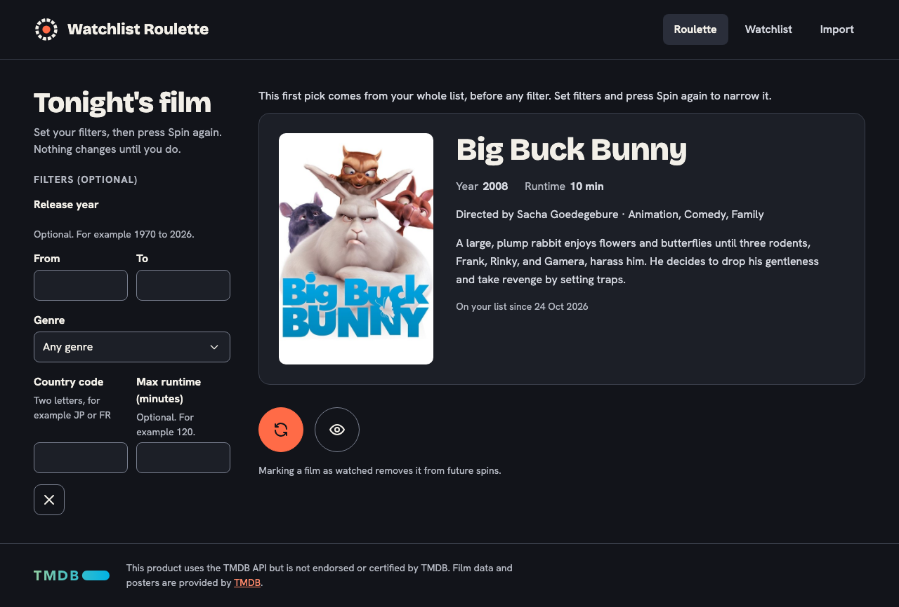

# Roulette

Route `/`. Picks a random unwatched film. Code: `views/RouletteView.vue`, `stores/roulette.ts`, `filters.ts`, `components/FilmCard.vue`.

## What the user does

- The screen picks a film when it opens. Coming back keeps the filters (they live in the roulette store) and the last pick, which is reloaded: if it was watched or deleted in the meantime, a new film is picked with the same filters.
- While a pick is loading, **Spin again** is disabled, and an answer that arrives after a newer spin is dropped, so the screen always shows the last pick.
- **Spin again** (round icon button, or Enter in a filter field) picks another film with the current filters. Filters never spin on their own: changing a field does nothing until Spin again, so the pick does not jump while someone is typing. The intro line under the heading says so ("Set your filters, then press Spin again. Nothing changes until you do."); it is visible above the collapsed filters on narrow screens too.
- **First pick note:** the pick made on arrival uses no filters. While it is on screen, a note above the card says "This first pick comes from your whole list, before any filter. Set filters and press Spin again to narrow it." The note goes away with the next spin. It stays when the film is marked as watched, when the screen is left and opened again, and when that first pick was watched or deleted elsewhere and a new one is drawn on return (still no filter, no Spin pressed). After a failed first pick, **Try again** is a Spin, so its pick has no note. The status message for the first pick says "Picked X from your whole list", so screen reader users get the same information. It is kept as `automatic` in the roulette store; `spin(params, onArrival)` sets it.
- **Mark as watched** marks the shown film; it is excluded from future spins. The button is disabled once the film is watched.
- Optional filters: release year from/to, genre, country code, max runtime. **Clear filters** empties them.
- The fields have no placeholders, because example values such as 1970 or 120 look like entered values. Examples are visible hints instead, linked with `aria-describedby`: "Optional. For example 1970 to 2026." on the release-year group (the `fieldset`, so it covers both years) and "Optional. For example 120." on max runtime, like the country code hint.

## Layout and narrow screens

Side by side with the result (viewport 990px or wider) the filters are always shown. Below that they are stacked above the result, so they sit in a collapsible `
` panel whose summary reads "Filters" or "Filters (2 active)". It starts closed, so the pick and the **Spin again** button are on screen without scrolling. The breakpoint is the same in `RouletteView.vue` (CSS) and in `useMediaQuery('(min-width: 990px)')` (`media.ts`). 990px is a little above the width (976px) at which the filters (280px), the result (560px), the gap (40px) and the page padding (2 × 48px) fit next to each other.

- If **Spin again** finds an invalid filter, the panel opens (if it was closed) and focus moves to the first wrong field, so the error is never out of sight. The "Filters (optional)" heading stays for screen readers (visually hidden). Closed or open, the filters stay in the DOM, so the form keeps working.
- Where possible, fields share a row: country code and max runtime sit side by side, and so do the two years. The genre list and **Clear filters** take their own row. Inputs in a row stay level even if one field has a hint.
- This two-column grid is used at every width, also next to the result, so the form stays short at medium widths (about 990 to 1100px) where the filter column is only 280 to 340px wide.
- Known and cosmetic: when two fields in a row both show an error message and the messages wrap to different lengths, one input can sit slightly lower than the other.
- Without `matchMedia` the panel stays open.

## Backend

- `GET /api/films/random` with the filters as query parameters. The backend does the picking and only draws unwatched films, so the choice does not depend on what the screen has loaded.
- `PATCH /api/films/:id` with `{ "watched": true }`.

## Filters

`filters.ts` checks the fields before a request, with the backend's limits: years 1888 to 2100 (and "to" not before "from"), runtime a whole number of at least 1, country two letters (sent upper case). Errors are shown under the field and no request is sent. The genre list is TMDB's fixed list (`genres.ts`), because the backend has no genre endpoint.

## States

| State | Shown |
|---|---|
| loading | "Picking a film…" (`aria-busy`) |
| a film | the film card |
| `404` without filters | "Nothing to spin", with links to import and add |
| `404` with filters | "No film fits these filters" |
| server unreachable or error | an alert with the message and **Try again** |

A visually hidden `role="status"` element announces what happened ("Picked X", "X is marked as watched…", "Picking a film…").

## Accessibility notes

- The result region is announced through the status text, not by making the whole card live, so screen readers say the title instead of the full card.
- `v-model` on a number input gives a number, not text; `filters.ts` accepts both (found by a test).
