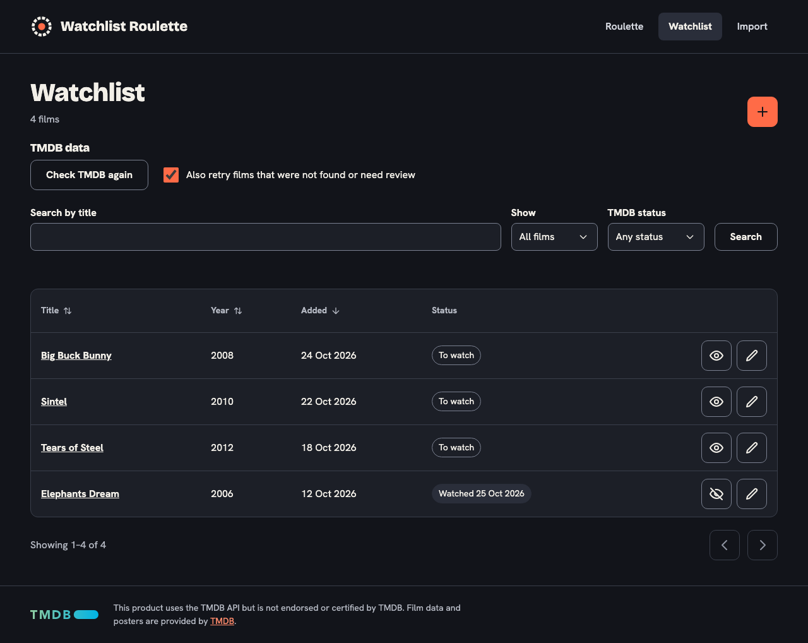

# Watchlist

Route `/watchlist`. All films in a table. Code: `views/WatchlistView.vue`, `stores/watchlist.ts`, `watchlistQuery.ts`.

## What the user does

- **Search** by title (Enter or the Search button), **Show** all/unwatched/watched, **TMDB status**, sort by date added, release year or title. Changing a select applies at once. Sorting is done with the column headers on wide screens and with the **Sort by** list on narrow ones (see [Sorting](#sorting)).
- Per film, as icon buttons: mark watched/unwatched, edit ([film form](film-form.md)), and for films with a TMDB problem **Choose match** ([TMDB match](tmdb-match.md)).
- **Add film** (plus button) opens the [film form](film-form.md).
- 50 films per page, with Previous/Next below the table, and above it too when there is more than one page (see [Pagination](#pagination)).
- **Check TMDB again** (see below).

## State in the URL

The screen's state lives in the query string, so a search can be bookmarked and the back button works: `?q=…&watched=false&tmdb=ambiguous&sort=year-asc&page=2`. Only non-default values are written. `watchlistQuery.ts` reads and writes it; unknown values fall back to the defaults.

### Coming back from a film

Whenever the watchlist's query changes, `WatchlistView.vue` hands it to the watchlist store (`rememberList`). The store's `listLocation` getter (`/watchlist` plus that query) is what every "back to the list" link and redirect uses: **← Back to watchlist** and **Cancel** on the [details](film-details.md), [add and edit](film-form.md) and [TMDB match](tmdb-match.md) pages, and the redirect after saving, adding, deleting or matching. So search, filters, sort and page are still there after opening a film. **Reset search** empties the remembered query. Marking a film as watched does not change the URL, so the list stays as it was. The query is kept in memory only: after a reload of the page, or when a film page is opened directly, the way back leads to the plain `/watchlist`. It is not copied into the film page addresses, and the browser's back button works as before.

TMDB status choices (`tmdb`): `pending` (Pending), `ambiguous` (Needs review), `not_found` (Not found), `error` (Lookup failed), `matched` (Matched); the default is any status. One status at a time. The names are short versions of the badge texts in the table (the badges are defined in `WatchlistView.vue`, the filter names in `watchlistQuery.ts`), and the value is sent as the backend's `tmdbStatus`. An unknown value in the URL is ignored. Use it to find films that need attention, for example **Needs review**, then **Choose match**.

Sort choices: `added-desc` (default), `added-asc`, `year-desc`, `year-asc`, `title` (A to Z), `title-desc` (Z to A). They map to the backend's `sort` and `order`.

## Sorting

One sort state (`sort` in the URL) with two controls; only one of them exists at a time, at the same 800 px breakpoint as the card layout (`useMediaQuery('(max-width: 800px)')`, which falls back to the list without `matchMedia`):

- **Wide screens:** the **Title**, **Year** and **Added** headers are buttons inside the `<th>` (the pattern from the WAI-ARIA Authoring Practices). **Status** and **Actions** are not sortable. The sorted column's `<th>` has `aria-sort="ascending"` or `"descending"` (the others have none) and an arrow icon (`aria-hidden`) shows the direction; the other sortable columns show a neutral up-down icon. The button's accessible name is just the column name (WCAG 2.5.3).
- **A click** sorts by the column's natural order first (Title A to Z, Year newest first, Added newest first) and reverses it on the next click (`SORT_COLUMNS`, `nextSort` in `watchlistQuery.ts`). It keeps the search and filters of the URL, ignores text typed in the search field but not yet sent, and goes back to page 1. The status line says "Sorted by release year, newest first". Because the list is replaced by a loading message while it reloads, focus is put back on the header button once the list is shown again.
- **Narrow screens:** the column headers are not visible in the card layout, so the **Sort by** list is shown there instead, with the six choices above. On wide screens the list is not in the page at all.

## Pagination

Below the table: `nav` "Pagination, bottom" with "Showing 1–50 of 120" and Previous/Next. Above the table, only when there is more than one page: `nav` "Pagination, top", compact, with "Page 2 of 3" and the same buttons, so a long list can be paged without scrolling down. Both are the `components/PageNav.vue` component with different names, because two navigation landmarks need different names for screen readers.

## Check TMDB again

The section "TMDB data" above the filters (`components/TmdbCheckPanel.vue`) looks up the films again that are waiting for TMDB or failed, and, with the checkbox **Also retry films that were not found or need review** (on by default), films that were not found or have several matches. Films you matched by hand keep their match.

- **Check TMDB again** sends `POST /api/tmdb/sync` with `{ includeUnmatched }`, then asks `GET /api/tmdb/sync` every two seconds while the run goes. While it runs the button reads "Checking… 12 of 40" and is `aria-disabled` (clicks ignored; not `disabled`, so the focus is not lost) and the checkbox is disabled.
- A `role="status"` line below the button says "Checking TMDB…" at the start and, when the run is done, "TMDB check finished: 31 matched, 6 not found, 1 needs review, 2 failed, 3 could not be reached." (the "failed" and "could not be reached" parts only when there are some). If the backend restarted during the run and no summary exists, it says "The check did not finish. Try again." If the run ended early it adds that TMDB rejected the access token, or that TMDB is having trouble. When no film is waiting it says "Nothing to check: no film is waiting for TMDB." The line is not updated for every film, only at the start and the end, so screen readers are not flooded.
- When the run is done the list reloads, so the new badges show.
- Failures show an alert (`role="alert"`): the server's sentence for TMDB problems ("TMDB is not configured. Set TMDB_ACCESS_TOKEN."), the usual texts for an unreachable server. Polling stops on leaving the page; the run itself goes on in the backend.

## When TMDB is off

The screen asks the backend once whether TMDB is configured (`stores/tmdb.ts`, `GET /api/tmdb/sync`, field `enabled`; the token itself is never sent). When it is not, the "TMDB data" section shows `components/TmdbOffNotice.vue` instead of the **Check TMDB again** controls: "TMDB data is turned off, so films get no poster or details. Set TMDB_ACCESS_TOKEN and restart the app." The text sits in a `role="status"` region that is filled one tick after it appears, so screen readers announce it, and it does not rely on color. The per-film **Choose match** buttons are hidden, and the pending badge reads "TMDB data is off". The same notice is on the [film details](film-details.md) page. If the question fails or is still open nothing changes: a missing hint is better than a wrong one (so the check controls show for a moment before the notice replaces them). Only "on" is remembered: while TMDB is off the screen asks again each time it is opened, so after setting the token and restarting the app the hint goes away when the user opens the watchlist or a film again. The badges for films that are matched or have a problem do not change. The [match page](tmdb-match.md) is still reachable by its address: with TMDB off a chosen match is saved and the film's data is fetched when TMDB is turned on. With a token set, nothing is different.

## Backend

- `GET /api/films` with `q`, `watched`, `tmdbStatus`, `sort`, `order`, `page`, `pageSize`.
- `PATCH /api/films/:id` with `{ "watched": true | false }`; the row is replaced by the answer.
- `POST` and `GET /api/tmdb/sync` for **Check TMDB again**, see [TMDB enrichment](../backend/tmdb-enrichment.md#checking-again).

## Table

A real `<table>` with a hidden caption, column headers (sortable ones are buttons, see [Sorting](#sorting)) and the title as row header. The title links to the film's [details page](film-details.md), in the same tab; the Letterboxd and TMDB links are on that page. The status column shows "To watch" or "Watched <date>", and a warning badge for `ambiguous` ("Needs review: several TMDB matches"), `not_found` and `error` lookups. A film that is still `pending` shows a neutral badge "Waiting for TMDB data" (no warning color and no **Choose match** button, because nothing is wrong yet); it goes away once the lookup has run and the list is loaded again (the screen does not refresh by itself, except after **Check TMDB again**). Without a `TMDB_ACCESS_TOKEN` every film stays pending; then the badge reads "TMDB data is off" instead (see [When TMDB is off](#when-tmdb-is-off)). `matched` films show nothing extra.

### On small screens

Up to 800 px wide (phones and small tablets) the table does not fit, so each film is shown as a **card** instead (WCAG 1.4.10, reflow: no horizontal scrolling at 320 px). It is still the same `<table>`; only CSS changes (`WatchlistView.vue`, media query `max-width: 800px`):

- the title (the link to the film's page), then "year · Added *date*", then the status badges, then the action buttons, which are always on screen,
- the column headers are hidden visually but stay in the page for screen readers,
- the word "Added" before the date is drawn by CSS with an empty alternative text, so screen readers do not read it twice (they get the column name from the table). Browsers that do not know that syntax (Firefox before 128, Safari before 17.4) keep a plain version of it, so the label is never lost; there a screen reader may read "Added" twice.

Because some screen readers (VoiceOver) drop the table meaning when a table is styled as blocks, the table, row groups, rows, headers and cells carry explicit ARIA roles (`table`, `rowgroup`, `row`, `columnheader`, `rowheader`, `cell`). They repeat what the elements already mean, on purpose. Above 800 px (and at widths in between, such as 800.4 px when zoomed) the normal table is shown, with a minimum width of 720 px; the card layout is the only thing the media query changes.

The layout is checked in a real browser (`e2e/app.spec.ts`) at 320, 375 and 799 px (no page wider than the screen, every action button on screen, headers hidden but present) and at 801 px (table with visible headers).

## States

Loading, load error with **Try again**, an empty list ("Your watchlist is empty", with links to import and add), and no results for a search ("No films match your search", with **Reset search**). A `role="status"` line below the filters announces results of actions ("X is marked as watched.", "X was added.") and is cleared when the screen is left.
